# Real Burp comparison: fix-head rerun

Measured November 22, 2026, Asia/Jerusalem. Report only, no application changes.

## Result and scope

All seven supplied fix heads close their narrow target regressions in fresh local checks. Base64 Decoder and byte Comparer still pass on the Repeater fix head. This is **not an integrated-build verdict**: each fix was compiled and exercised separately. It is not a sweep of every fixture on every head or a claim of complete Burp parity.

The reference is actual Burp Community 2026.11.2, temporary project, using loopback fixtures. Earlier paired observations are in [the original eight-area comparison](https://github.com/Chaim12345/webprobe/pull/112) and [the follow-up comparison](https://github.com/Chaim12345/webprobe/pull/113). New Decoder reference measurements are included below. The original WebProbe baseline was `cc7407d579046da45c84b7f2beb69982b3b388e5`.

Only local origins were used. No PortSwigger account, license key, payment or external scan was used. Vendor binaries and extracted vendor APIs are deliberately excluded. This branch starts from `parity/2026-11-17` at `7be2efd44949006526df1ea3616290d9979e67c6` and contains evidence only, not a synthetic combination of the fixes.

## Exact-head matrix

| Fix | Measured head | Real Burp reference | Fresh WebProbe observation | Verdict |
|---|---|---|---|---|
| [#114](https://github.com/Chaim12345/webprobe/pull/114), extension request Drop | `10dece9f11b94e36703bd3348ca3797890185528` | Origin not contacted; client receives HTTP 200 local HTML | Unchanged demo extension drops `/admin-drop`; HTTP 200, 233-byte HTML, no-store, connection close; repeated origin-hit delta 0 | Narrow GET drop gap closed |
| [#115](https://github.com/Chaim12345/webprobe/pull/115), Repeater HTTP handler | `de14370593e3a173c2578bb78ff801df9958fb47` | Registered HTTP handler adds the probe header to Repeater traffic | Actual GUI Send reaches origin with `probe_header=1`; request editor remains unmodified | Narrow handler gap closed |
| [#116](https://github.com/Chaim12345/webprobe/pull/116), Sequencer constant tokens | `f733f4c10654cd4162905b8f286fc35f6644a6d8` | 1,024 identical length-20 tokens: Extremely poor, 0 effective bits | Same file: Extremely poor, 0 effective bits at all five significance levels; no contradictory sample error or 88,513-bit entropy claim | Constant-token gap closed |
| [#117](https://github.com/Chaim12345/webprobe/pull/117), Intruder baseline | `8cd730f9e4d5d7da8b465931f1b27d74e94f2be7` | Baseline plus two payload requests | GUI attack finishes three HTTP 200 rows: row 0 blank baseline, row 1 `one`, row 2 `two`; origin sees baseline first | Baseline gap closed |
| [#118](https://github.com/Chaim12345/webprobe/pull/118), analyzers | `5080e2175f85aa431959a0bf5222263545294b9e` | Case-insensitive keyword counts; empty keyword accepted; variations factory returns an object | `TOKEN` and `token` both become variant; empty keyword accepted; factory returns `VariationAnalysis` | Narrow API entry-point gaps closed |
| [#119](https://github.com/Chaim12345/webprobe/pull/119), Logger row menu | `eb00353905b4d691f635bf7973442b3e3496a929` | Row menu offers message-aware send actions | Real Logger row opens menu; Send to Repeater preserves request and loopback target; Send to Organizer creates the actual Inbox item | Menu and two dispatch paths closed |
| [#120](https://github.com/Chaim12345/webprobe/pull/120), Organizer collections | `e5dc0b8` | +New makes empty named collections; external sends go to Inbox even with a custom collection selected | +New makes `New collection`, then `New collection (2)`; rename works; confirmed deletion removes only the temporary collection; Repeater Send to Organizer leaves selected CollectionProof empty and adds the request to Inbox | Creation, naming, rename, deletion and Inbox destination pass |

The #114 success also retained demo request/response mutation: origin sees the demo header and client receives `X-Montoya-Seen`. On #115, Proxy traffic also has the probe header, while direct extension HTTP send has none, matching the narrow Burp reference. On #118, direct send returns 200 and extension-populated tools remain available.

### Original eight-area fixture accounting

- Proxy and extension mutation: rerun on #114 and #115, with origin evidence.
- Repeater: fresh actual Send on #115, including handler mutation and unchanged editor.
- Intruder: fresh actual Sniper attack on #117, one insertion point, two simple payloads and baseline.
- Decoder: `SGVsbG8=` produces `Hello` on #115; expanded real-Burp codec measurements are separate below.
- Comparer: `alpha` versus `alpHa` remains one byte difference, hex `68` versus `48`, on #115.
- Sequencer: constant-token fixture rerun on #116, including all five significance levels.
- Custom Montoya extension/analyzers: fresh Java probe on #118.
- Repository demo extension Drop: fresh local GET drop and mutation on #114.

Logger and Organizer are additional follow-up fixtures. No full unit-test suite was rerun for this evidence report. #119 initially failed to link under memory pressure with Burp resident, then compiled after Burp was stopped. An optional later rebuild for an additional manual-Intercept check timed out; it is not counted as a measured result.

## Decisive screenshots

### Repeater, Sequencer and Intruder

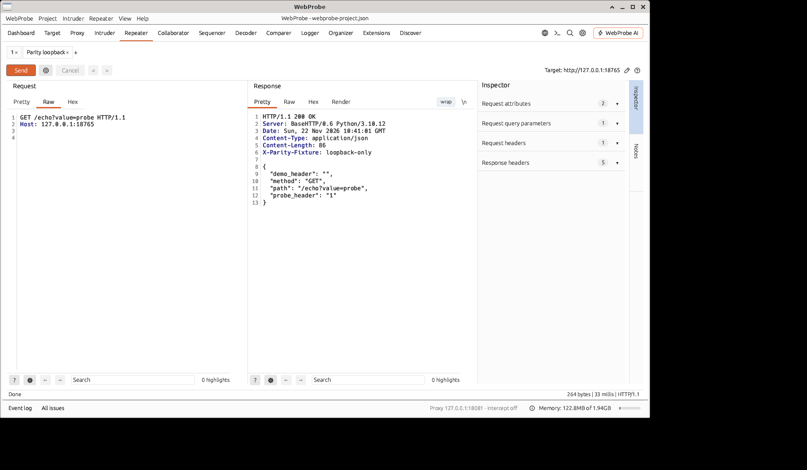

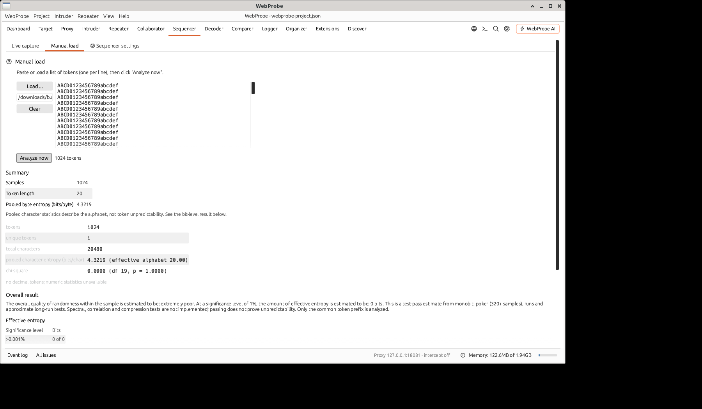

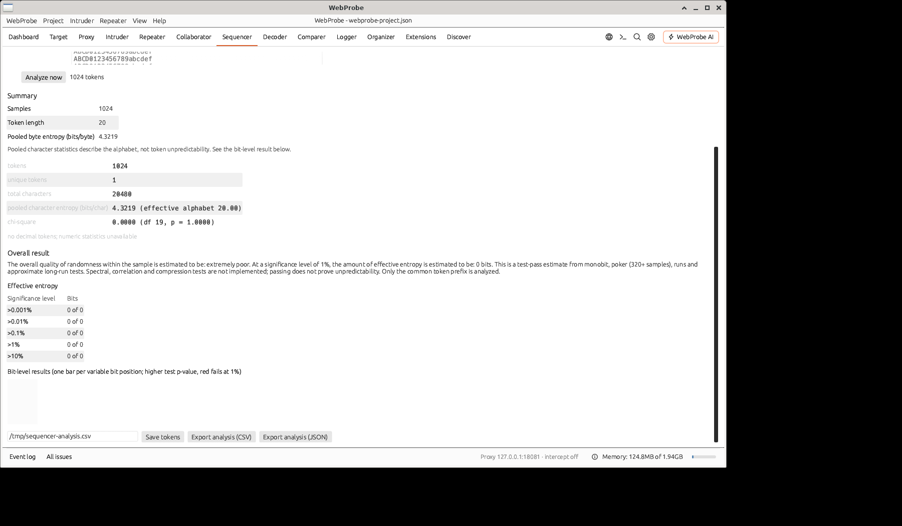

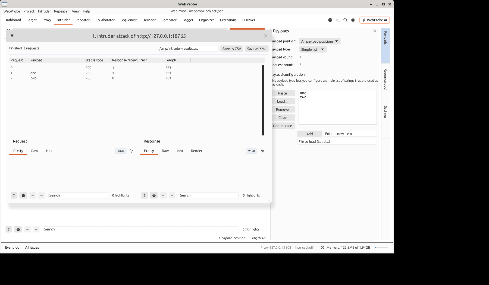

### Logger and Organizer

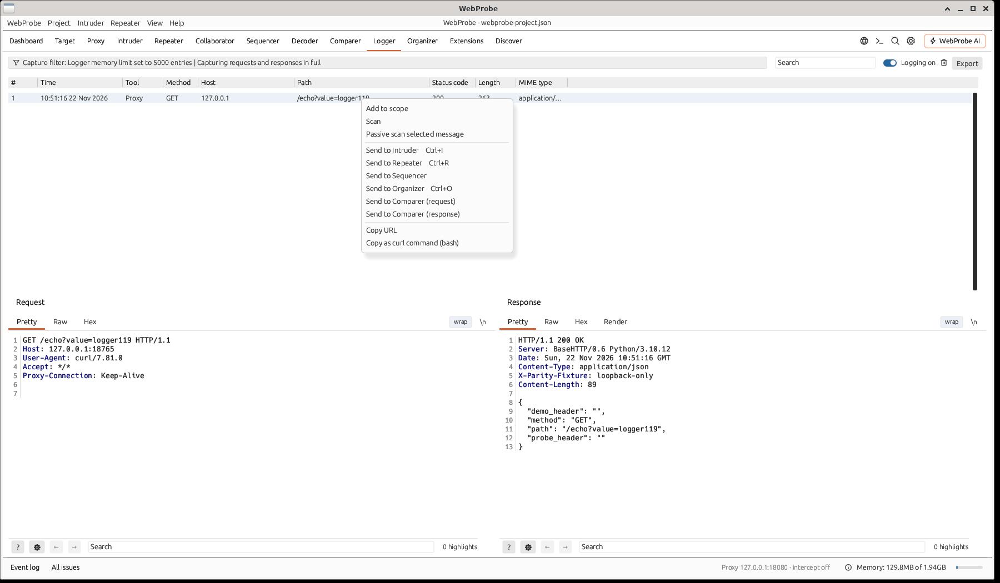

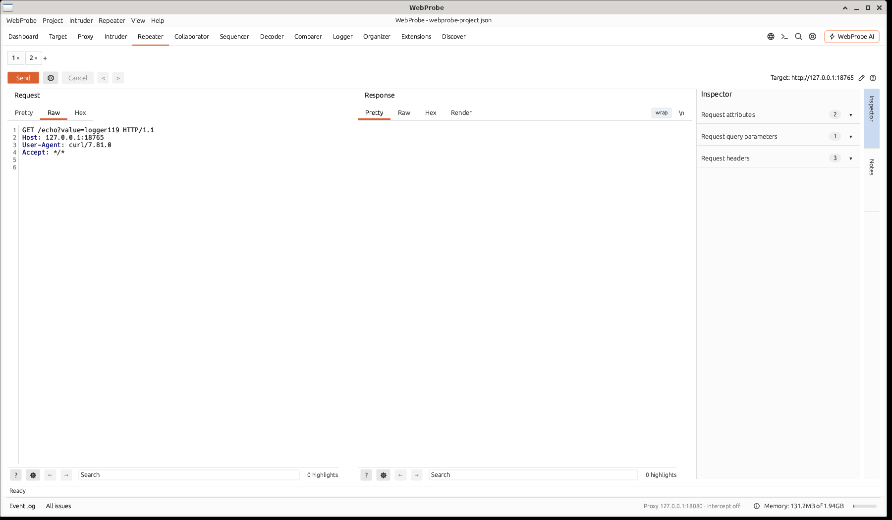

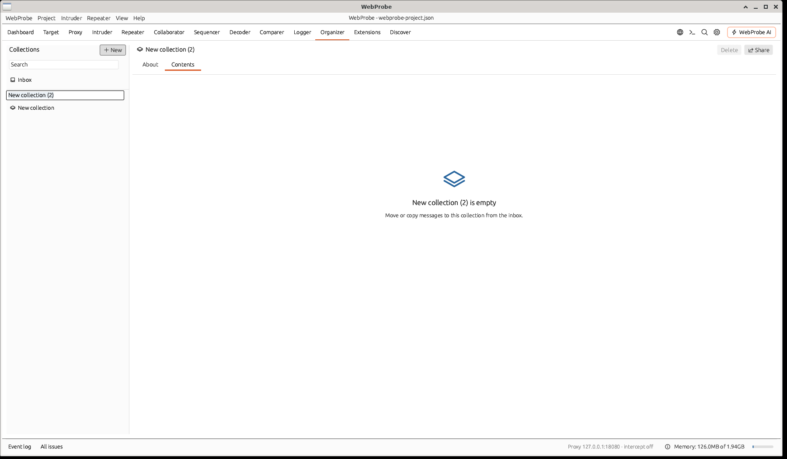

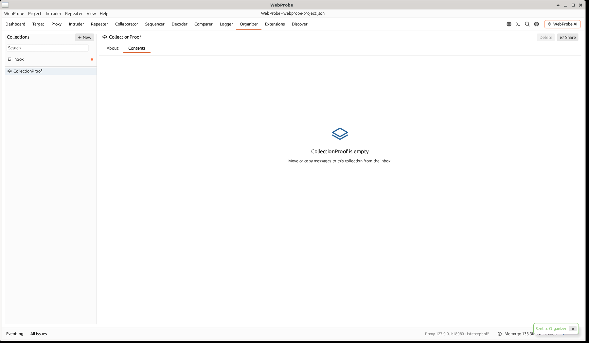

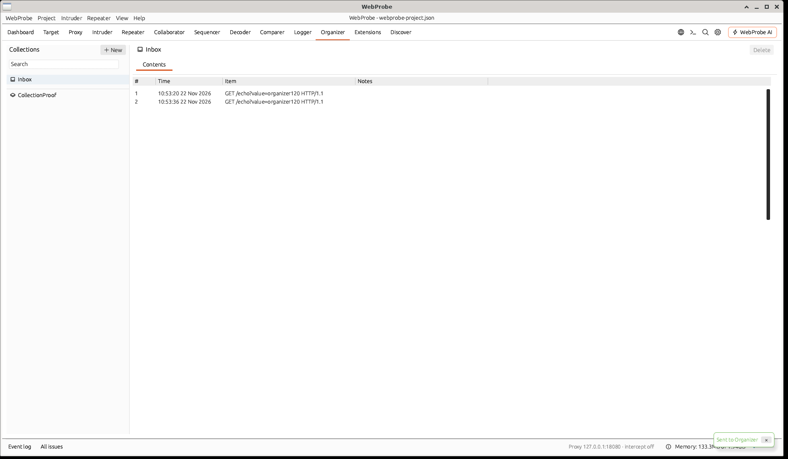

## Expanded real-Burp Decoder reference

[Exact inputs, outputs and the complete observed Hash menu](decoder-measurements.md).

Octal and Binary convert numeric tokens between radices, rather than converting character bytes: Encode Octal `72 105` gives `110 151`, while Encode Binary gives `1001000 1101001`. `Hi` remains `Hi`. Decode Octal `110 151` gives `72 105`; backslashes remain in the slash-delimited version. These observations matter when implementing the missing operations.

Gzip encode of `hello` gives 25 bytes and switches the result to Hex view. Decode Gzip returns exactly `hello` in a third panel.

Smart decode is not an unrestricted recursive decoder in this reference. The nested URL/Base64/URL fixture only advances through its first layer automatically; the next Base64 layer requires explicit Decode as Base64, then Smart decode handles the final URL layer. Do not replace this measured behavior with an assumed recursive contract.

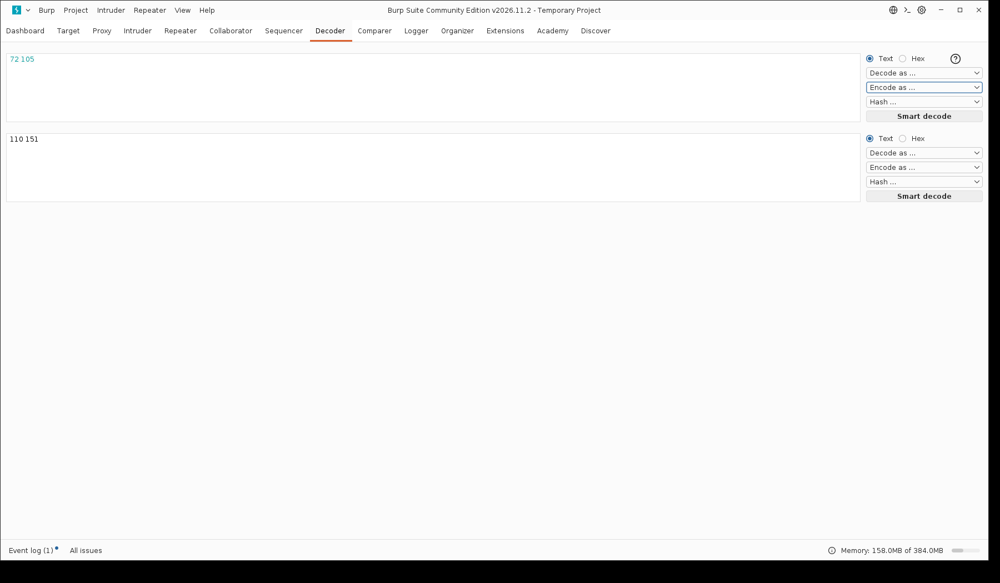

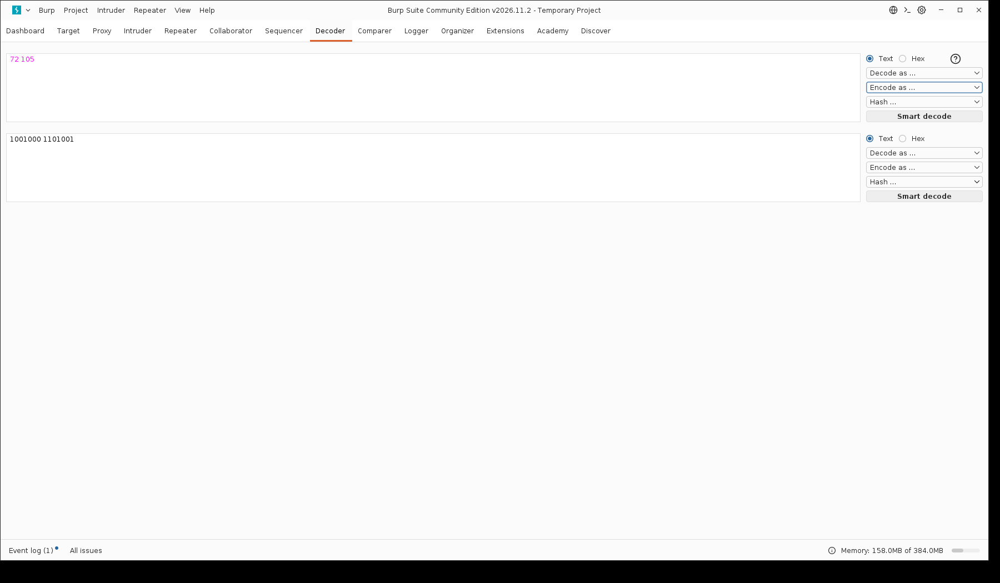

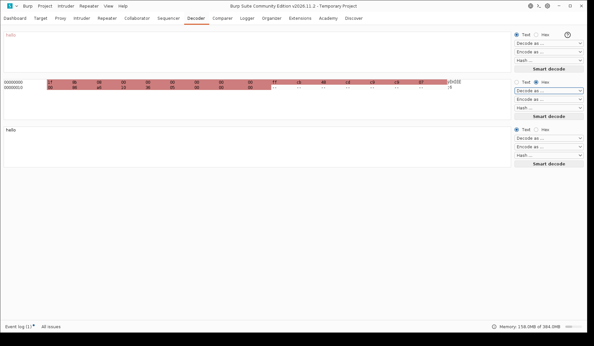

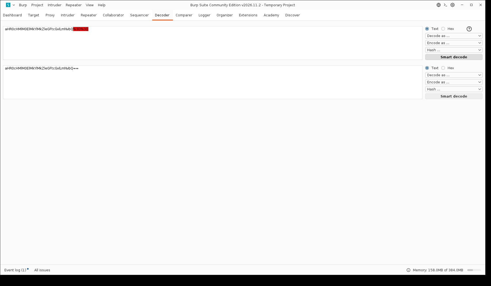

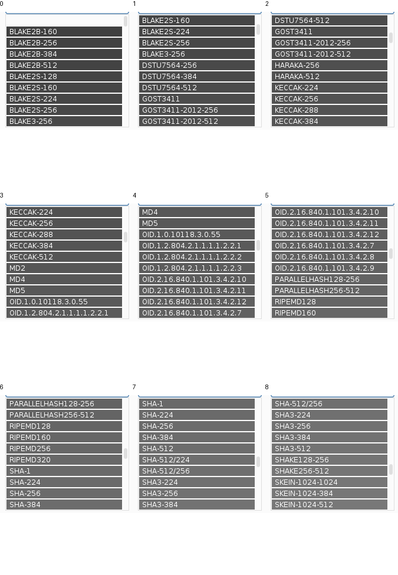

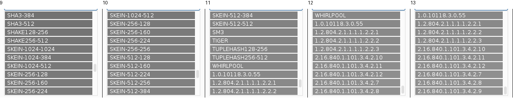

## Next work, in priority order

These priorities distinguish measured differences, current-source limitations, and missing validation. They are not claims that every pending branch lacks the feature.

1. **Integrate and rerun the cross-tool/extension chain.** Separate-head success is not combined-head success. Recheck Proxy request and response hooks, Repeater redirects, Intruder baseline handlers, Logger sends and Organizer destination on one approved integration head. Real Burp automatic redirects carry the handler-mutated request forward: the append-header probe has one header on hop 1 and two on hop 2. Automatic Send leaves the editor unchanged; manual Follow changes it to the manual hop. This expanded behavior was not freshly rerun on #115 here.
2. **Decoder byte safety and operation coverage.** The inspected #120 source still exposes String-based stages, lossy binary-to-text conversion, four hash actions, and no Octal, Binary or Gzip actions. Actual Burp has byte/Hex Gzip roundtrip and the much larger menu recorded here. Add byte-preserving stages before calling binary operations equivalent. Measure Smart decode compatibility rather than assuming recursive decoding is the target.
3. **Sequencer beyond the constant-token regression.** #116 fixes the dangerous identical-token result, not general statistical equivalence. The implementation documents missing spectral, correlation and compression tests. Compare biased, periodic, correlated, variable-length and random controls against real Burp before presenting broad effective-entropy parity.
4. **Response-variation metrics, not only object construction.** #118 proves factory construction and keyword behavior. It does not establish each variation attribute, aggregation rule, malformed-response behavior or edge-case result. Add a real-Burp golden corpus and compare values.
5. **Manual Intercept Drop response semantics.** The earlier paired follow-up measured origin suppression in both, but Burp returned local HTML while WebProbe returned curl error 52. #114's fresh check covers extension GET Drop only. Manual Drop, response Drop, HEAD and HTTP/2 need their own fresh result before broad drop closure is claimed.
6. **Traceability and workflow breadth.** Earlier paired observations showed UTC-like Logger time versus Burp local time, and host-only versus full-URL/connection-ID WebSocket history. #119/#120 do not prove those presentation differences closed. Next exercise Organizer move/copy, notes and persistence; Logger's remaining dispatch actions; WebSocket binary, fragmented, compressed and WSS traffic; and match/replace regex, response rules and ordering.

Active Scanner and Collaborator are edition-gated in the real Community reference. They remain unverified, not failed parity claims. Do not fabricate a Professional reference or expand the licensed scope to close them.

## Reproduction and evidence

`evidence/manifest.json` names measured heads and hashes the included evidence. `checks114.json` records the drop origin delta and mutation outputs. Java probe sources, analyzer output, Intruder CSV, HTTP bodies/headers and inspected screenshots are included. No application JAR, API JAR, class file, token or credential is included. Raw HTTP header captures intentionally retain CRLF and the terminating blank line; CSV retains its original line endings.

Use the same loopback fixture and original constant-token file from the preceding report. Compile each head separately, with one application using proxy port 18080 at a time and HTTP origin port 18765. Load the unchanged demo for #114 and the custom probe for #115/#118. Trigger actual desktop actions for Repeater, Intruder, Logger and Organizer. The narrow assertions above describe exactly what was observed; more complex behavior needs another fixture, not an inference from these passes.
