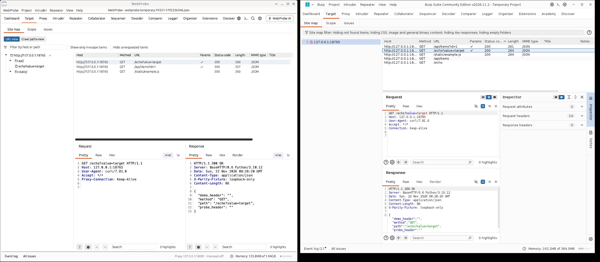
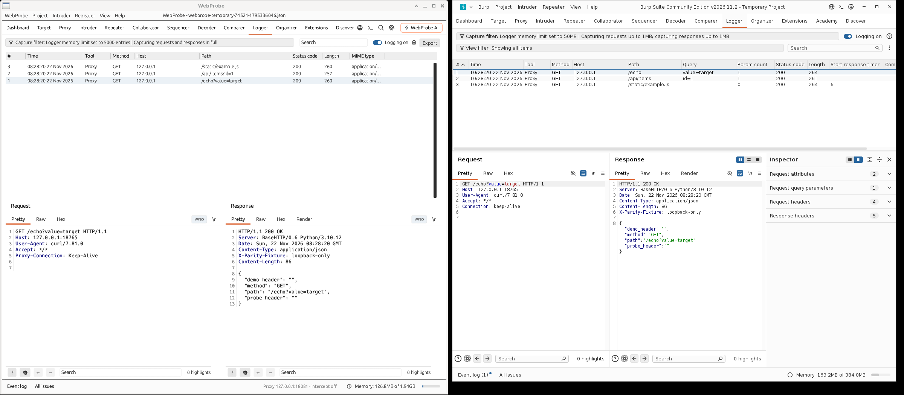
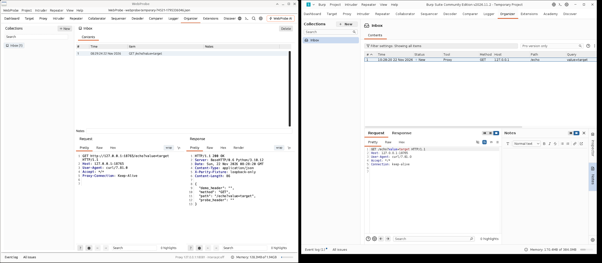
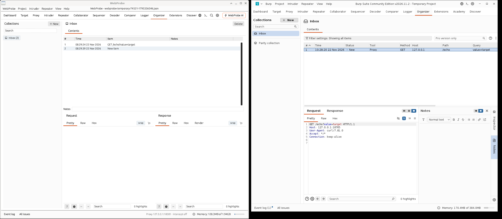
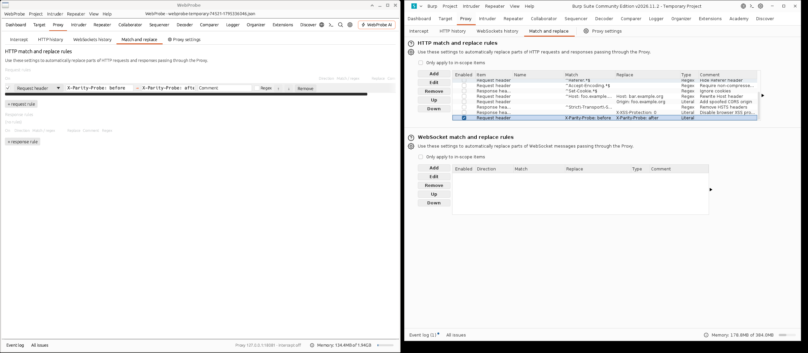
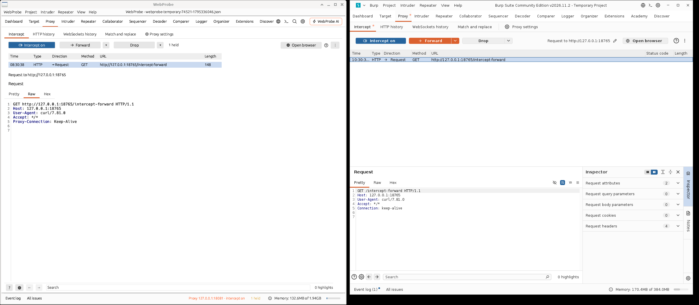
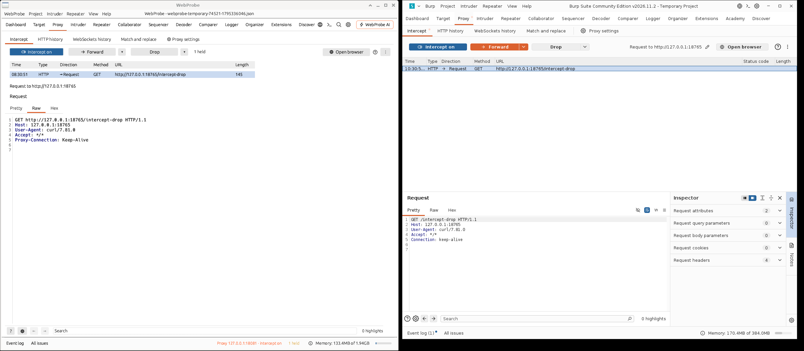
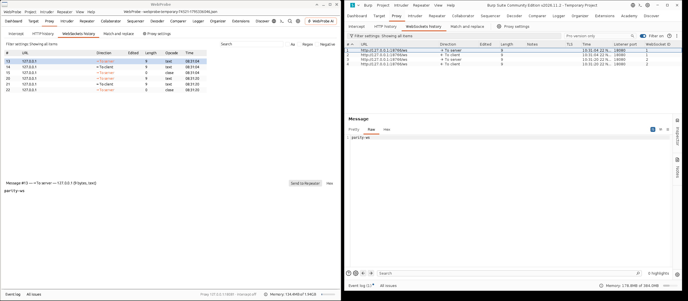
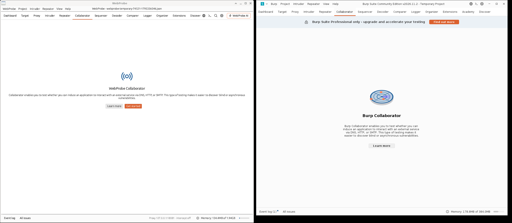
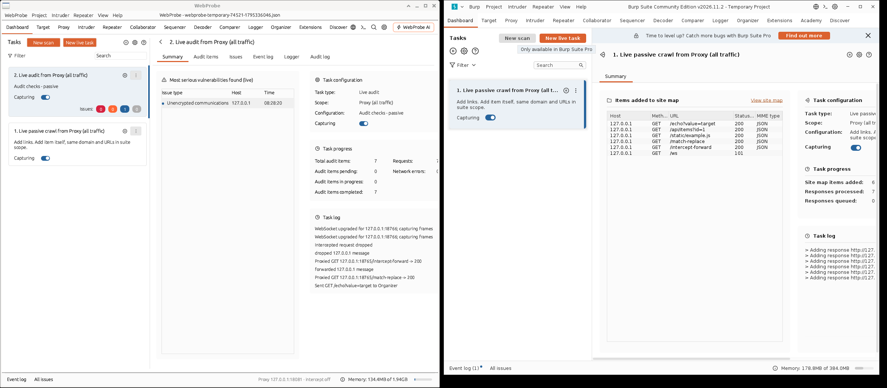

# Real Burp comparison, remaining tool areas

Date: 2026-11-22, observed around 10:28-10:33 Asia/Jerusalem.

This report continues [the first real-Burp comparison](https://github.com/Chaim12345/webprobe/pull/112). The same local HTTP and WebSocket inputs work through both applications in the paths tested here. The clearest new functional differences are Organizer collection creation and Logger's missing row action menu. Time display and WebSocket URL presentation also differ. Collaborator and active Scanner cannot be compared against this Community edition: the real application explicitly gates them to Professional.

## Baseline and limits

- WebProbe: [PR #99](https://github.com/Chaim12345/webprobe/pull/99), commit `cc7407d579046da45c84b7f2beb69982b3b388e5`.
- Burp: official Community 2026.11.2, temporary project. [Official release](https://portswigger.net/burp/releases/professional-community-2026-11-2).
- Report branch starts from `parity/2026-11-17` at `7be2efd44949006526df1ea3616290d9979e67c6`. The measured executable is the PR #99 baseline, not a build of that base or a combined set of later fixes.
- Burp JVM: `-Xmx384m -Xss256k`; WebProbe Java sidecar launcher: `-Xmx128m -Xss256k`.
- Only loopback origins and listeners were used. HTTP origin: `127.0.0.1:18765`; WebSocket echo origin: `127.0.0.1:18766`; Burp proxy: `18080`; WebProbe proxy: `18081`.
- Both WebProbe extensions were disabled; the fresh Burp session had no extension loaded. This sweep measures core behavior rather than extension hooks.
- Screenshots place WebProbe on the left and real Burp on the right. Different pane layouts and default filters are not, by themselves, functional failures.
- No account, license key, payment, external Collaborator callback, active external scan, vendor JAR, vendor class, or extracted vendor API is included or required by this report.

## Results

| Area | Real Burp Community | WebProbe baseline | Classification |
| --- | --- | --- | --- |
| Target / site map | Three requested paths have HTTP 200 and inspectable messages | Same three paths and responses are inspectable | Basic capture passes |
| Logger capture | Same three Proxy transactions are listed with request and response | Same three transactions and messages | Basic capture passes |
| Logger row actions | Right-click exposes Send to Organizer, Repeater, Intruder and other actions | Right-click on the selected row opens no menu | Functional UI gap |
| Logger time | Same request is shown as 10:28:20 | Shown as 08:28:20 | Timezone presentation difference |
| Organizer import | Sending the selected message adds an Inbox item with its request and response | Same basic import and message inspection work | Basic import passes |
| Organizer Collections +New | Creates an editable named collection | Adds an empty Inbox item named `New item` | Functional UI gap |
| Match and replace | Literal request-header rule changes `before` to `after` at the origin | Same header change at the origin | Tested rule passes |
| Intercept | Holds request; Forward reaches origin; Drop does not | Same hold, Forward and origin-blocking behavior | Core controls pass |
| Drop client result | Local HTML error page | Empty reply, curl error 52 | Existing response-semantic gap reproduced |
| WebSocket proxying | HTTP 101, text echo, inbound/outbound text in history | Same HTTP 101 and text echo in history | Basic text exchange passes |
| WebSocket history | Full URL, connection ID; text entries | Host-only URL column; also lists close frame | Presentation / control-frame differences |
| Collaborator | Explicit Professional-only banner | Has its own start page | Edition-gated comparison, not a parity verdict |
| Scanner | New scan disabled; tooltip says it is only available in Pro | New scan is offered; a local passive audit is visible | Active scan comparison is edition-gated |

## 1. Target and Logger

The same three GET paths were sent through both proxies:

- `/echo?value=target`
- `/api/items?id=1`
- `/static/example.js`

Both site maps show the three successful transactions. The selected `/echo?value=target` messages have the same JSON fields, including empty extension-marker headers. Burp also presents inferred request-only path entries without responses; those are not extra successful origin responses and are not counted as failures.

Both Logger tables capture the three requests. At the time of the screenshot, WebProbe shows 08:28:20 and Burp shows 10:28:20 for the same origin transactions. The environment clock and requested comparison timezone are Asia/Jerusalem, UTC+02 at capture. The HTTP Date header is GMT. Neither visible table labels its timezone. This is a display difference, not evidence of requests happening two hours apart.

Burp's Logger row context menu was used to send the selected request to Organizer. The corresponding right-click was attempted twice in WebProbe without a menu. Source inspection at the measured commit supports the observation: the Logger row handler in `app/src/ui/views.rs`, `logger_view`, handles left-click selection and does not attach a context menu. Proxy history's working Send to Organizer action was used instead. This distinction matters because WebProbe's Intruder empty-state text advertises Logger as a source for Send to Intruder.

## 2. Organizer

Both applications can import the same request/response into the Inbox and show its messages. WebProbe displays an absolute-form request line in this view while Burp displays origin-form; the selected transaction is the same.

The Collections +New action is not equivalent. In Burp Community it creates a collection that can be named `Parity collection`. In WebProbe it increments the Inbox count and creates an empty item named `New item`, with no collection appearing in the rail. The measured source in `app/src/ui/views.rs`, `organizer_view`, explicitly calls `organizer.add` from that button and gives it a New item in the Inbox tooltip. This is not a Professional-edition limitation in the reference application.

Collection move/copy, status changes, persistence and richer notes are not covered by this fixture. The report does not claim equivalence for them.

## 3. Match and replace

An enabled literal Request header rule was added in both:

- Match: `X-Parity-Probe: before`
- Replace: `X-Parity-Probe: after`

A request with the original header was sent to `/match-replace`. Both origin responses report `probe_header` as `after`. The saved JSON outputs are byte-identical. The screenshot shows the custom Burp rule selected at the bottom of its HTTP rule list, not an unrelated default rule.

Only this literal request-header case is established. Response rules, regex captures, empty-match header insertion, rule ordering and WebSocket rules were not exercised.

## 4. Intercept

With Intercept enabled, identical `/intercept-forward` requests were held in both UIs. Forward released each one and both returned the expected origin JSON. The origin log contains exactly two such requests.

Identical `/intercept-drop` requests were then held and dropped. Neither path appears in the origin log. Burp returns its local dropped-by-user HTML page, while WebProbe closes the request with an empty reply and curl error 52. This reproduces the response-semantics difference seen earlier with extension-driven dropping; it is not a second independent origin-blocking defect.

The client bodies, WebProbe error and selected origin-log extract are preserved in `evidence/`. Intercept was turned off after these checks.

## 5. WebSockets

The local fixture performs an HTTP upgrade and echoes masked client text. Both proxies return HTTP 101 and the exact unmasked text frame `parity-ws`, nine UTF-8 bytes. Both histories show the outbound and inbound text and allow inspecting the payload.

Visible differences: WebProbe's URL column displays only `127.0.0.1`; Burp displays `http://127.0.0.1:18766/ws` and the WebSocket connection ID. WebProbe additionally lists the client close frame. These observations do not establish whether either application's optional control-frame filtering or connection metadata is configurable elsewhere.

An initial exploratory request used a 15-byte nonce. The saved client and final JSON results use a corrected 16-byte nonce, and that repeated exchange succeeded in both. The screenshot contains both exploratory and corrected text exchanges; the final fixture results are the corrected ones. Burp's first empty history view was refreshed by leaving and returning to the tab. It is not reported as a capture failure.

This is a small text-frame test, not a claim about binary frames, compression, fragmentation, WSS, message editing, extension WebSocket callbacks or WebSocket Repeater parity.

## 6. Community edition gates

Collaborator is explicitly Professional-only in the real application. No upgrade link was followed and no external interaction was generated.

Burp's New scan button is disabled and its tooltip says Only available in Burp Suite Pro. The default live passive crawl from Proxy is visible and records the local site-map traffic. WebProbe's own local passive audit is also visible. This does not provide a licensed reference for active Scanner behavior, so no active-scan parity judgment is made.

## Reproducibility and evidence

`evidence/manifest.json` records the measured commit, bounded JVM flags, listener ports, JAR checksum and hashes of the included evidence files. The JAR itself is intentionally absent.

`evidence/checks.json` contains ten true assertions covering six path echoes, both header substitutions, both forwarded requests, both WebSocket echoes, drop absence at the origin and the WebProbe drop error. These are narrow assertions over captured outputs, not the full application unit-test suite.

The fixture sources are included for local reproduction. Their output paths retain the original capture directory and should be adjusted when run elsewhere. Start the HTTP fixture on 18765 and WebSocket fixture on 18766, configure the two listeners, and keep Intercept off except during its explicit hold/release fixture. Configure the header rule described above before replaying the Match and replace request. `ws-client.py` sends the same corrected text exchange through each proxy and writes its JSON results.

The original eight-tool fixtures remain in the preceding report. No later fix head was supplied during this sweep, so this report does not claim that a pending fix has passed or failed. Fix reruns must name their exact head and must not silently replace this baseline.

## Suggested fix order

1. Make Organizer Collections +New create a collection and give items a collection assignment, rather than creating an empty Inbox item.
2. Route Logger context-menu actions through the same message-aware dispatch used by Proxy history.
3. Choose and label a consistent display timezone across the timestamp-bearing views.
4. Preserve full URL and connection identity in the WebSocket history presentation, while deciding deliberately how control frames should be shown.

The first two are functional UI workflow gaps. The last two are presentation and traceability differences. Broader feature coverage and Professional-only behavior remain unverified.
