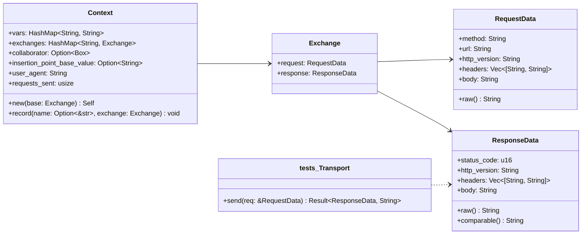
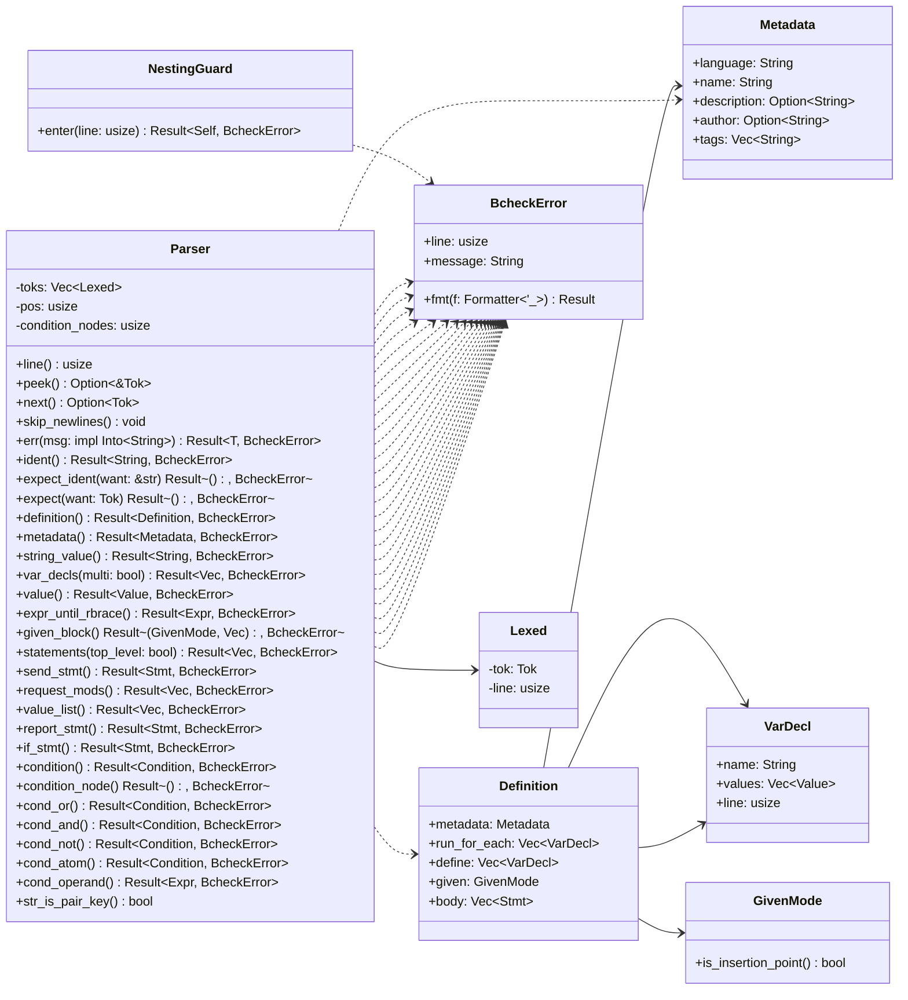
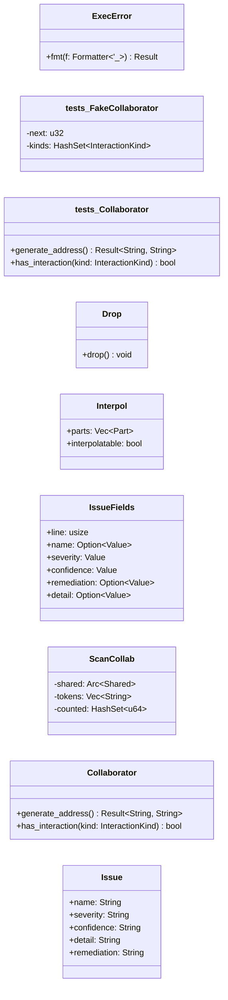
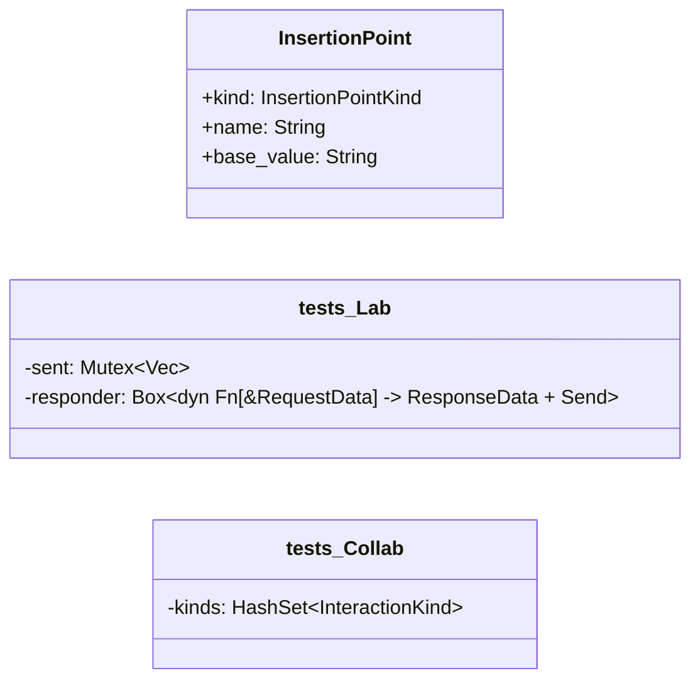

# Engine: BCheck parser and runner

Generated by `scripts/gen-uml.sh` from `app/core/src/bcheck`. Do not edit by hand.

## Part 1 of 4: RequestData, ResponseData, Exchange, Context ...

## Part 2 of 4: NestingGuard, Metadata, GivenMode, VarDecl ...

## Part 3 of 4: ExecError, tests_FakeCollaborator, tests_Collaborator, Drop ...

## Part 4 of 4: InsertionPoint, tests_Lab, tests_Collab

