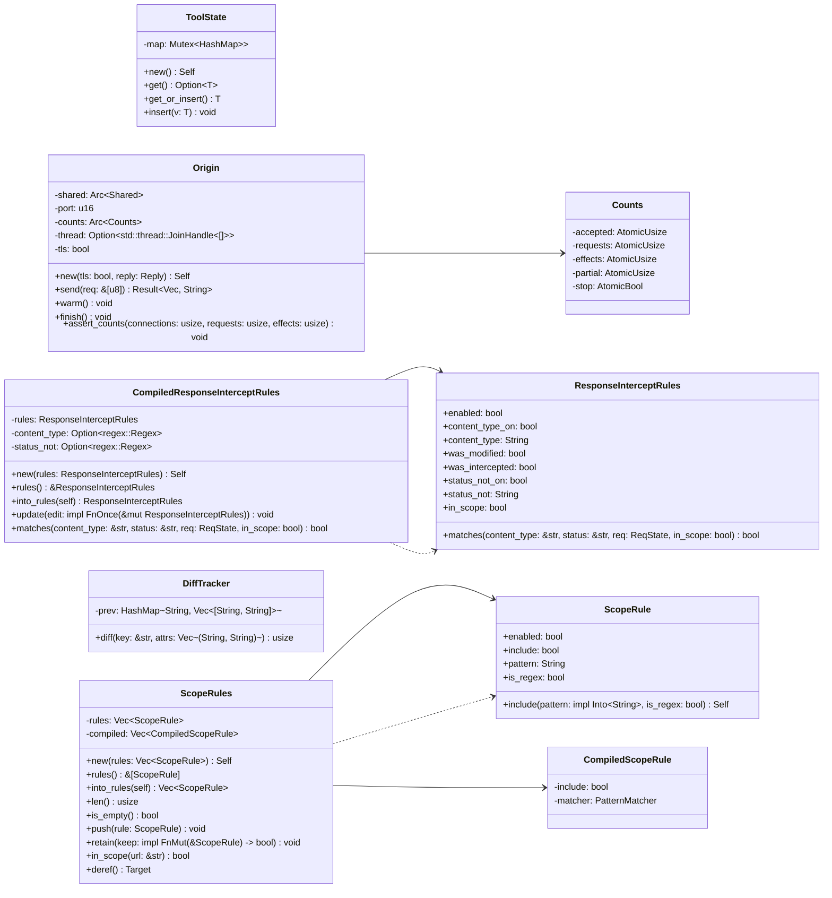
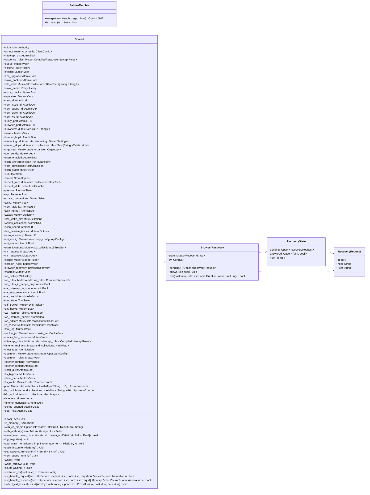
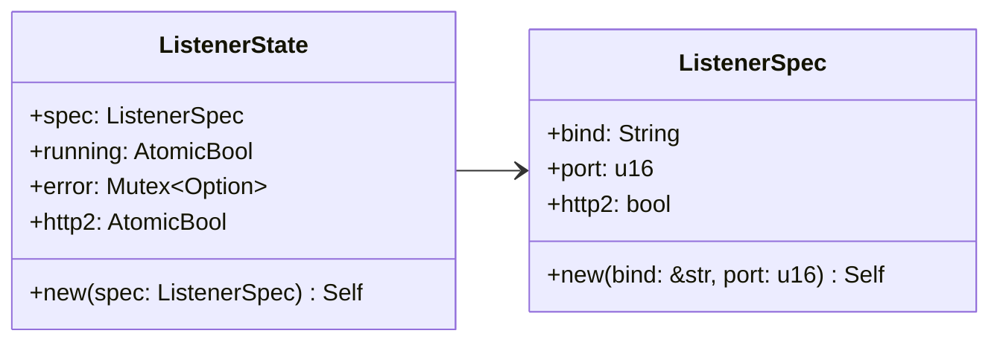
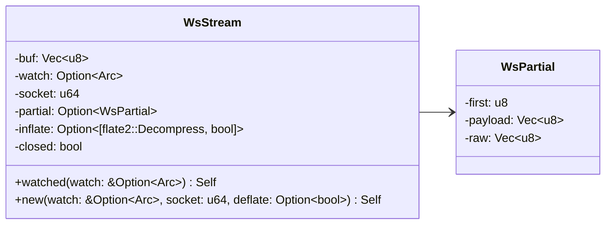
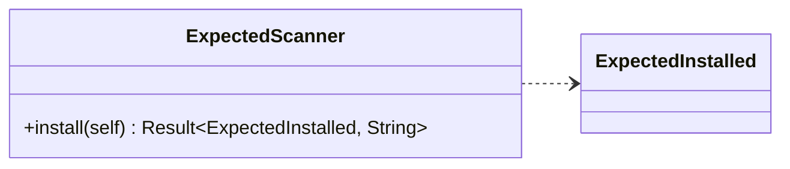
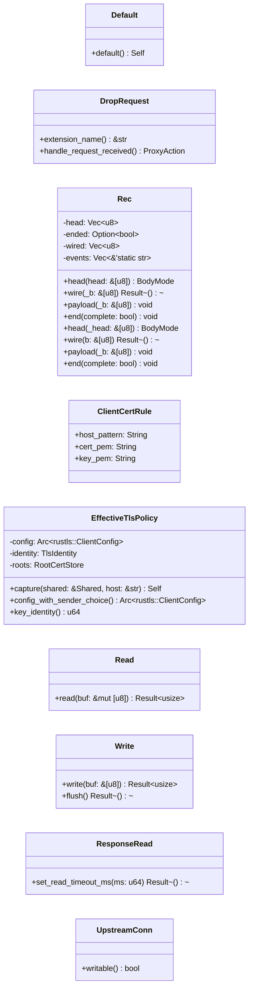
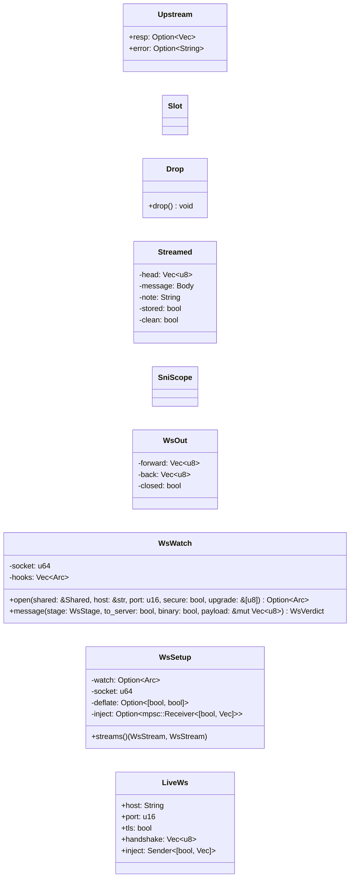
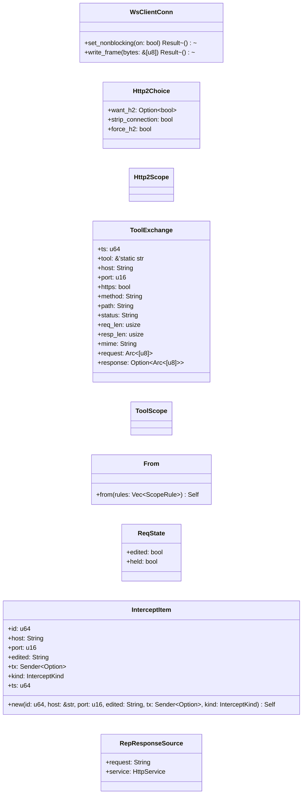
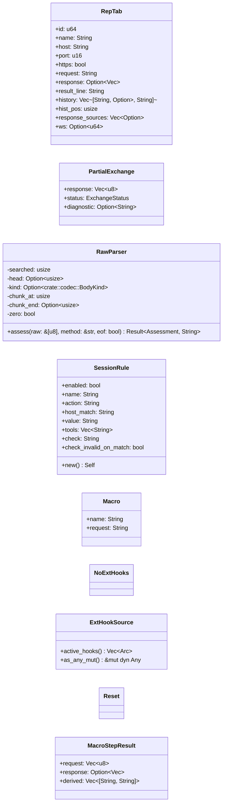

# Engine: proxy, interception, sending, shared state

Generated by `scripts/gen-uml.sh` from `app/core/src/net`. Do not edit by hand.

## Part 1 of 9: ToolState, Counts, Origin, ResponseInterceptRules ...

## Part 2 of 9: PatternMatcher, Shared, RecoveryRequest, RecoveryState ...

## Part 3 of 9: ListenerSpec, ListenerState

## Part 4 of 9: WsPartial, WsStream

## Part 5 of 9: ExpectedScanner, ExpectedInstalled

## Part 6 of 9: Default, DropRequest, Rec, ClientCertRule ...

## Part 7 of 9: Upstream, Slot, Drop, Streamed ...

## Part 8 of 9: WsClientConn, Http2Choice, Http2Scope, ToolExchange ...

## Part 9 of 9: RepTab, PartialExchange, RawParser, SessionRule ...

