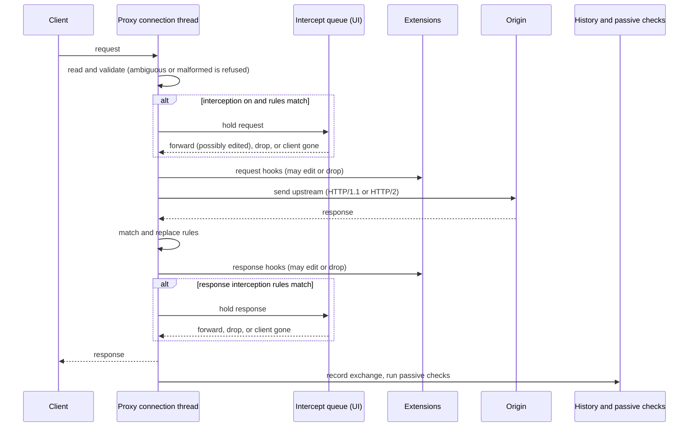
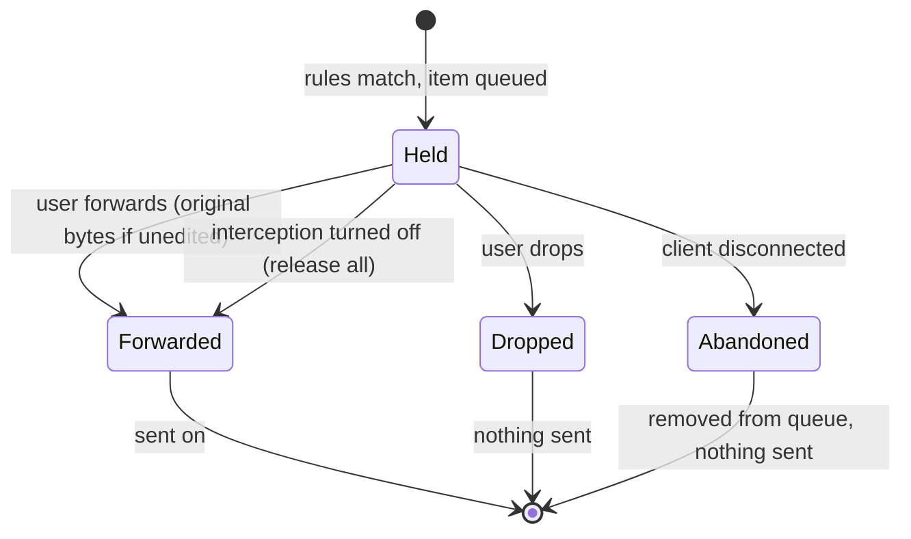
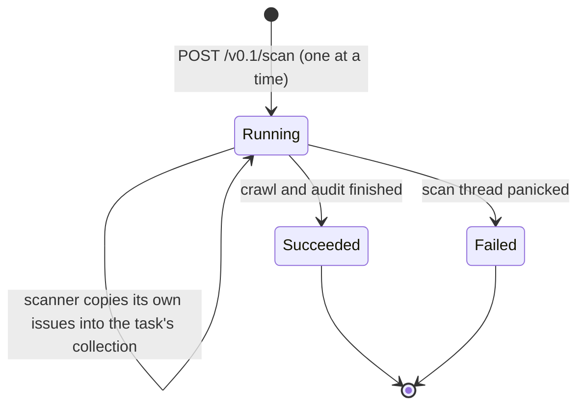

# Flows and states

Written by hand from the code (not generated). Class diagrams do not show
these: Rust has no inheritance, and the interesting structure here is the
order of steps and the states a held message moves through.

## A proxied HTTP request

`net/engine.rs` (`serve_plain`, `serve_mitm_conn`, `upstream_and_deliver`) and
`net/intercept.rs`.

## A held intercept item

`intercept_request` / `intercept_response` wait in `intercept_wait`, which
polls the client's liveness every 200 ms.

## A REST API scan task

`rest_api.rs` and `scan_run.rs`.

