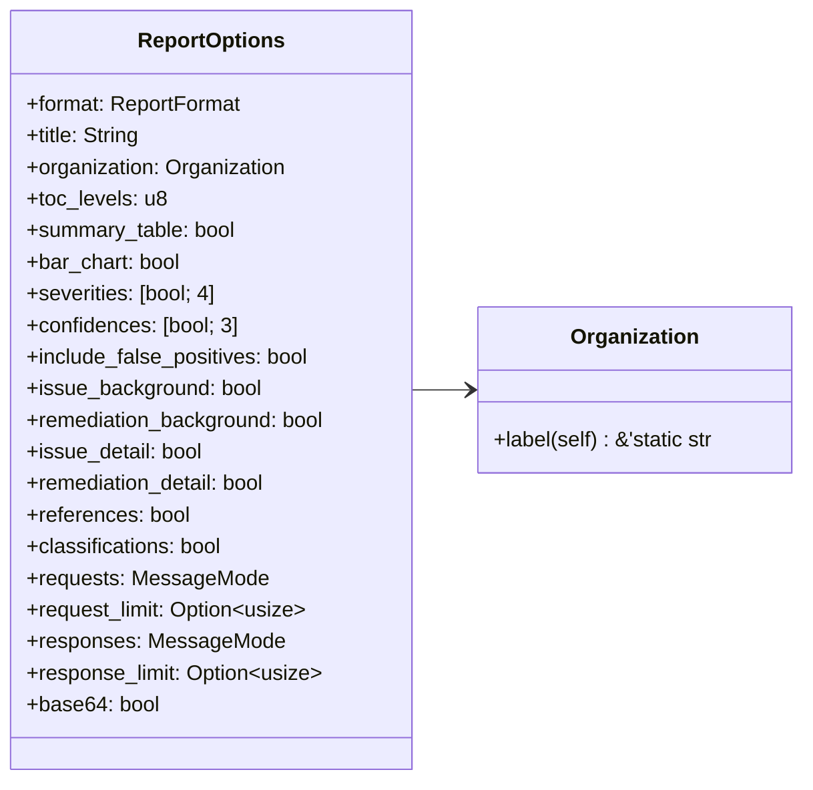
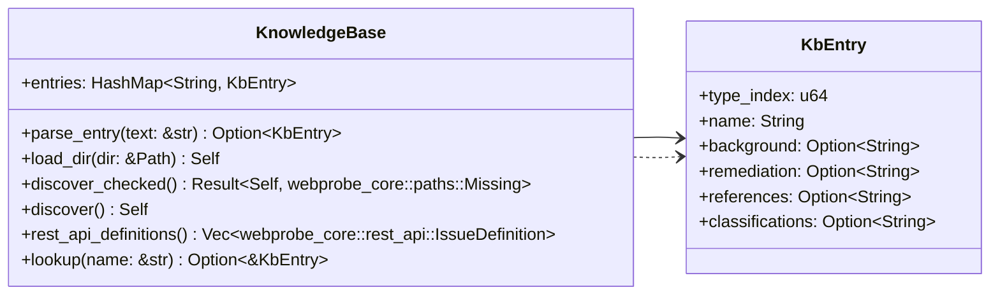
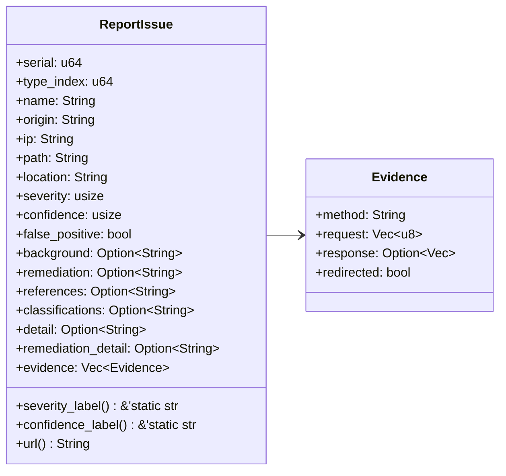
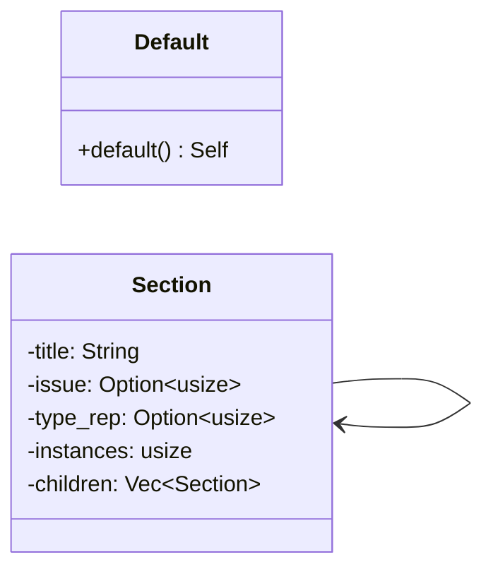

# Report crate (HTML and XML scan reports)

Generated by `scripts/gen-uml.sh` from `app/report/src`. Do not edit by hand.

## Part 1 of 4: Organization, ReportOptions

## Part 2 of 4: KbEntry, KnowledgeBase

## Part 3 of 4: Evidence, ReportIssue

## Part 4 of 4: Default, Section

