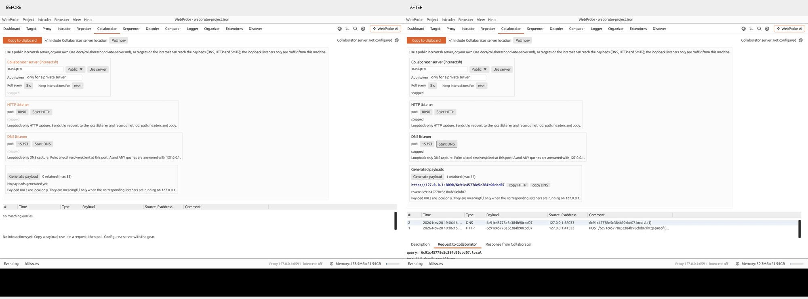
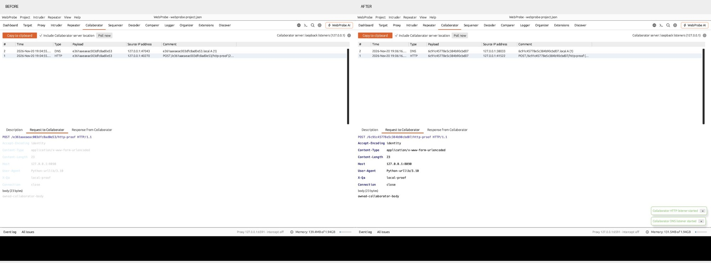

# UI QA continuation, 2026-11-20

Base: PR #87 (`team/ui-qa`, f914169). Work is isolated on `team/ui-qa-2`.

## Live workflow results

Run with a debug desktop build under Xvfb at 1440x1000, using only owned loopback fixtures. Fixture server: 127.0.0.1:8099. Proxy: 127.0.0.1:6591. No external target was scanned.

- **Repeater:** captured a real GET through the proxy, sent it to Repeater, clicked Send, received HTTP 200 plus the fixture HTML. Independent fixture log recorded the second request.
- **Intercept:** turned interception on, verified one held request with no new fixture hit, clicked Forward and received the expected response. A second held request was dropped; curl reported an empty reply and the fixture log did not gain that path.
- **Intruder:** sent a request to Intruder, set a query value, clicked Auto positions, pasted alpha/beta/gamma, then Start attack. Finished 3 requests, all 200, no errors. The fixture log contained all three substituted values. Selected-result request/response panes populated.
- **Scanner:** live/passive scan produced 9 issues across two fixture pages, including cleartext password submission, cookie without HttpOnly, and password autocomplete. Selected advisory showed the correct host, path and severity. This does not claim active scan coverage.
- **Sequencer:** sent the captured response request to Sequencer, selected the session cookie, started capture. Collected 100 tokens, all unique, and auto-analysis displayed the entropy/chi-square summary. The stop count clamps to a minimum of 100. The fixture log increased by exactly 100.
- **Collaborator:** started local HTTP and DNS listeners, generated a payload, sent a real POST and UDP DNS A query. HTTP returned 200 and DNS returned 127.0.0.1. Both interactions appeared with the generated token. Selected HTTP request displayed headers and body. Stopping listeners changed the visible state back to stopped. Public interactsh and SMTP were not exercised.

## Fix

Collaborator still used hard-coded dark-theme colors on the light page. This made the Generated payloads heading invisible and status, URLs, captured HTTP headers/body and DNS/SMTP details hard to read.

- Use palette-aware ink/header/editor colors for text.
- Keep the running green cue, using a darker green in light mode.
- Add two regression tests, including >=4.5:1 contrast against both chrome and content backgrounds in Light, Dark and HighContrast palettes.
- Visually rechecked settings and real captured HTTP request in light and dark modes. SMTP color changes are covered by shared tokens, not a live SMTP interaction.

## Verification

- `cargo fmt --all --check`: clean.
- `cargo clippy --locked --workspace --all-targets -- -D warnings`: clean, default features.
- `cargo test --locked --workspace`: 784 passed, 0 failed, 12 ignored. Desktop 138, core 550, report 12, support 84.
- Two new contrast tests included in the desktop total.

The local build overrides the checkout-specific compiler/wrapper/linker paths. Existing PR #87 and all other branches remain untouched. This branch depends on PR #87 and includes its earlier UI fixes when compared directly to parity.
