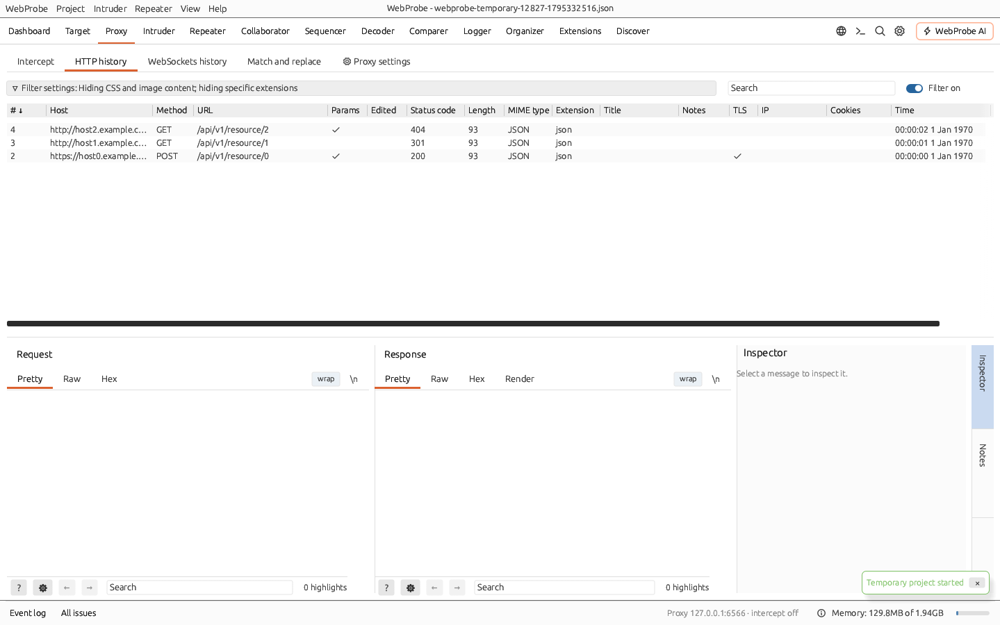
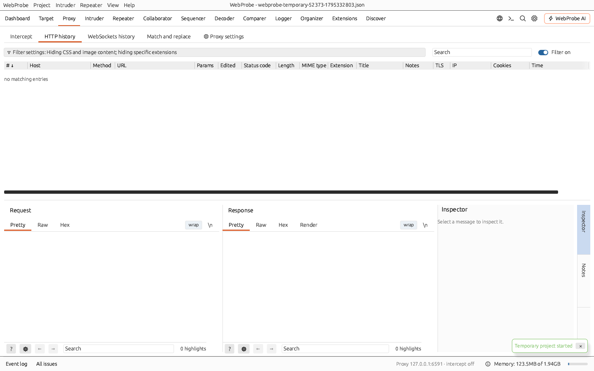
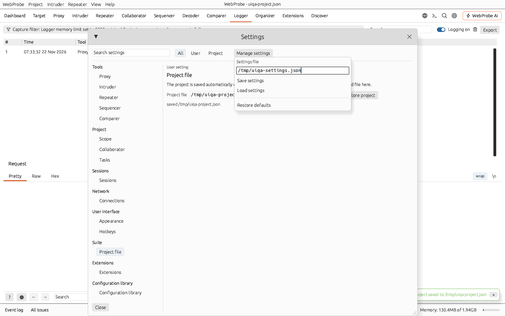
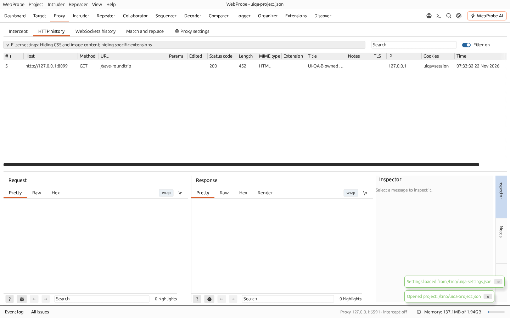
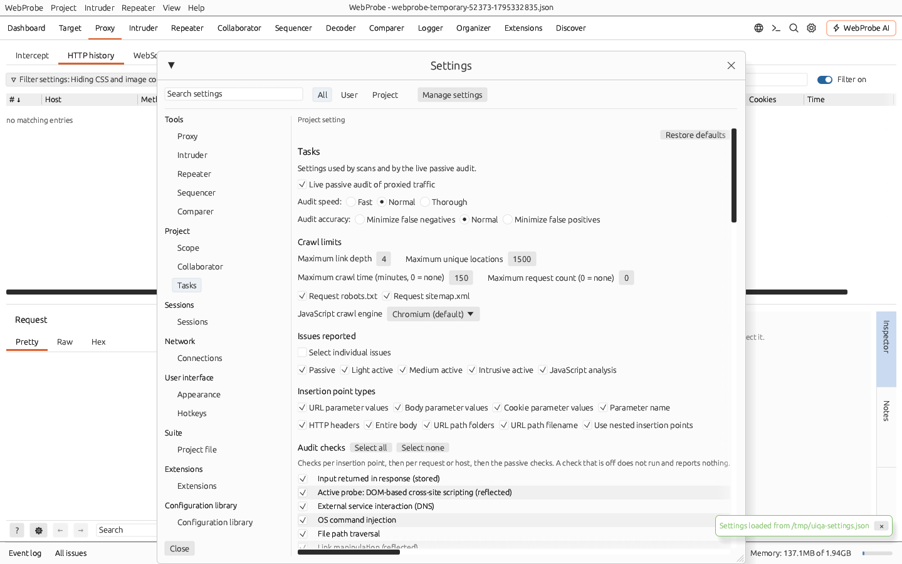
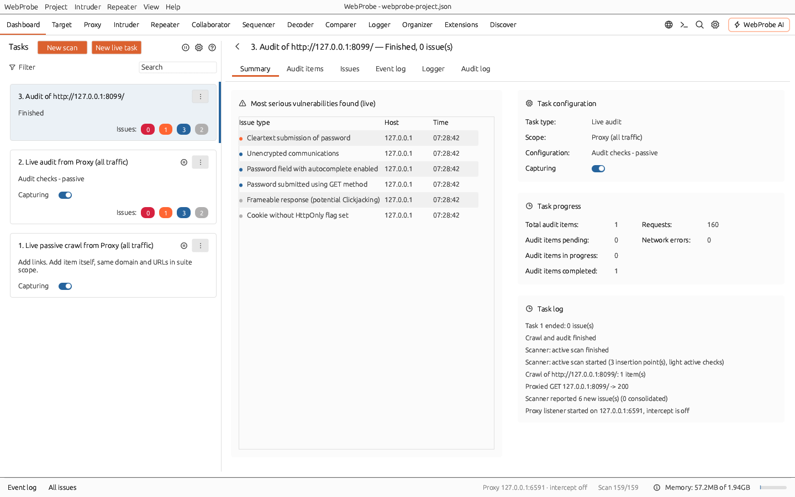

# UI QA B: projects, settings and scanner, 2026-11-22

Base: PR #93, `456516829e625d1b45f5d2b252eb137fcc9f8696`.
Branch: `team/ui-qa-b-20261122`. Existing UI fixes from #87, #90 and #93 are retained, not reimplemented. This branch is stacked on #93; only the final commit is new work.

## Fixed

### New projects inherited the previous session

The project chooser used the settings-only installer to create an empty project. That installer correctly preserves traffic for settings imports, but is wrong for creating a project. HTTP history, findings, Repeater tabs, scan tasks and editor buffers could carry over into the new project and be saved there.

New projects now use the full project replacement path. Temporary projects also clear the selected history row.

Baseline reproduction: seed three history rows, choose Project > New temporary project. The title and success toast change, but the rows remain:

After the fix, the same steps produce an empty HTTP history and an empty Logger:

### Opening an empty project retained Logger rows

Logger restore skipped empty saved lists, leaving rows from the previous project visible. Restore now replaces the Logger even when the saved list is empty, resetting its body-retention bookkeeping and selection.

### Settings file path could not be edited

Manage settings used the default close-on-any-click menu behavior. Clicking its path field dismissed the menu, preventing custom-path import/export. It now closes on outside clicks; Save, Load and Restore defaults still close explicitly.

## Live workflow checks

Desktop debug build under Xvfb, 1440x900 app window. Requests were limited to an owned fixture at `127.0.0.1:8099`, through proxy `127.0.0.1:6591`. No external host was scanned.

- Captured a real GET `/save-roundtrip`, HTTP 200, plus six passive findings.
- Saved the project to `/tmp/uiqa-project.json`. Independently read the file: one HTTP history entry, six findings and one Logger row.
- Started a new temporary project and verified the old rows were absent.
- Used Project > New or open project > Check, then Open to reopen the saved file. The HTTP history row and Logger row both returned, without duplication.
- Searched settings for `cookie` and selected the User pill. Only Repeater remained in the tree.
- Opened the Tasks settings page and checked scrolling and readable controls.
- Saved settings to a custom path. The exported settings file had no history, findings or Logger rows.
- Changed audit speed from Normal to Fast, then loaded the settings file. The visible speed returned to Normal.
- Started an audit of the owned fixture through Dashboard > New scan > Audit selected items. The task finished and the fixture's independent request log confirmed real scanner traffic. The active audit added no new findings on this fixture; the six existing findings were passive results.

## Regression evidence

Three new tests failed before the fix:

- `new_disk_project_does_not_inherit_session_data`: inherited HTTP history.
- `temporary_project_does_not_inherit_session_data`: inherited HTTP history.
- `opening_empty_project_clears_previous_logger`: inherited Logger rows.

All three pass after the fix. They check history, findings, Repeater tabs, paused scan tasks, Logger rows, editor contents and selection cleanup. The disk-project test also verifies the old project was saved before switching and that the new file contains none of its session data.

Final verification:

- `cargo test --locked --workspace --no-run`: passed.
- `cargo test --locked --workspace`: **787 passed, 0 failed, 12 ignored**. Desktop 141, core 550, report 12, support 84.
- `cargo fmt --all --check`: clean.
- `cargo clippy --locked --workspace --all-targets -- -D warnings`: clean, default features.

## Remaining scanner observation

Selecting a finished queued audit changes the detail header to that task, but the Summary pane still shows live-audit configuration and the global issue list. The screenshot above captures this mismatch: the header reports zero issues for the finished audit while the list shows the six passive findings. This patch does not fix that separate task-summary scoping problem. Task-specific summary accuracy, public Collaborator services, SMTP and external-target scans are not claimed.
